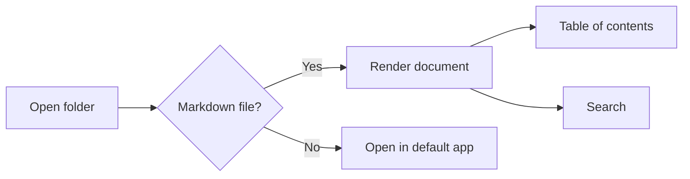
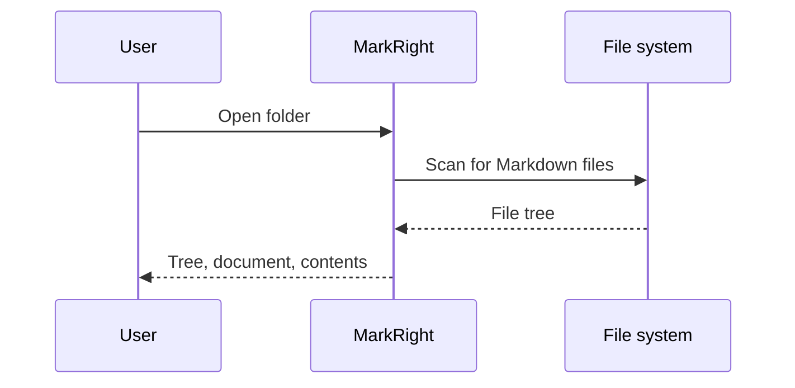
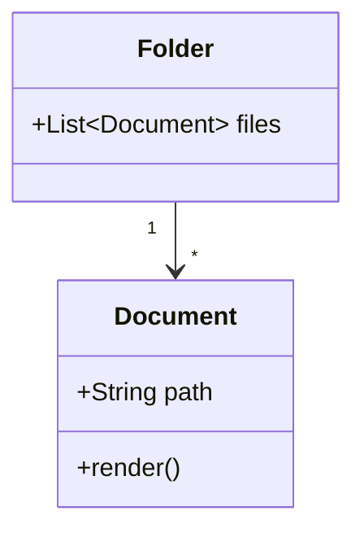
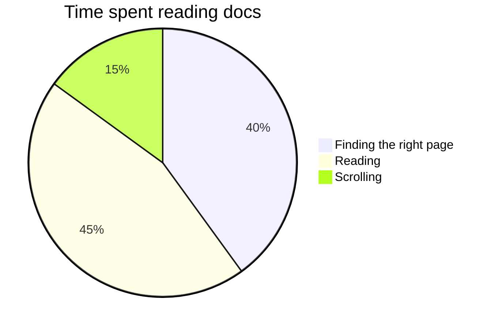
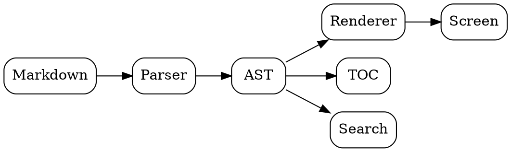

# MarkRight Showcase

Every rendering feature MarkRight supports, in one document. The YAML front matter above is read as metadata and is not shown. Use the table of contents on the right to jump between sections. :rocket:

## Text formatting

Plain text with **bold**, *italic*, ***bold italic***, ~~strikethrough~~, `inline code` and a [link to the Markdown Guide](https://www.markdownguide.org/).

Bare URLs become links: https://github.com/cybericius/MarkRight

A line ending with two spaces  
continues on a new line (hard break).

> A plain blockquote.
>
> > Nested inside another one.

---

## Headings

### Third level

#### Fourth level

##### Fifth level

###### Sixth level

## Lists

- Unordered item
- Another item
  - Nested item
    - Deeper item

1. Ordered item
2. Second item
   1. Nested ordered item

Task list:

- [x] Write the showcase
- [x] Render it in MarkRight
- [ ] Read every section

## Tables

| Feature | Syntax | Aligned right |
|:--------|:------:|--------------:|
| Bold | `**x**` | 1 |
| Math | `$x$` | 22 |
| Diagram | ` ```mermaid ` | 333 |

## Code blocks

```rust
fn main() {
    let greeting = "Hello, MarkRight";
    println!("{greeting}");
}
```

```typescript
const square = (n: number): number => n * n;
console.log([1, 2, 3].map(square));
```

```python
def fib(n):
    a, b = 0, 1
    for _ in range(n):
        a, b = b, a + b
    return a
```

```
A code block without a language.
```

## Math

Inline math: the area of a circle is $A = \pi r^2$, and Euler's identity is $e^{i\pi} + 1 = 0$.

Display math:

$$
\int_{-\infty}^{\infty} e^{-x^2}\,dx = \sqrt{\pi}
$$

A `math` code block:

```math
\begin{aligned}
\nabla \cdot \mathbf{E} &= \frac{\rho}{\varepsilon_0} \\
\nabla \times \mathbf{B} &= \mu_0 \mathbf{J} + \mu_0 \varepsilon_0 \frac{\partial \mathbf{E}}{\partial t}
\end{aligned}
```

A matrix: $\begin{pmatrix} a & b \\ c & d \end{pmatrix}$

## Diagrams

### Mermaid flowchart



### Mermaid sequence diagram



### Mermaid class diagram



### Mermaid pie chart



### Graphviz



## GitHub alerts

> [!NOTE]
> Useful information that users should know, even when skimming.

> [!TIP]
> Helpful advice for doing things better or more easily.

> [!IMPORTANT]
> Key information users need to know to achieve their goal.

> [!WARNING]
> Urgent info that needs immediate user attention to avoid problems.

> [!CAUTION]
> Advises about risks or negative outcomes of certain actions.

## Obsidian callouts

> [!info] Custom title with *formatting*
> Obsidian callouts accept a title after the type.

> [!success]
> Success, check and done look the same.

> [!question]- Folded callout (click to open)
> A `-` after the type starts the callout collapsed.

> [!example]+ Expanded callout (click to close)
> A `+` after the type starts it open, with a toggle.

> [!bug]
> Bug callout.

> [!quote] Ada Lovelace
> The Analytical Engine weaves algebraic patterns just as the Jacquard loom weaves flowers and leaves.

> [!abstract]
> Abstract, summary and tldr are the same type.

> [!danger]
> Danger and error are the same type.

## Footnotes

MarkRight collects footnotes at the end of the document.[^1] A footnote can be referenced more than once,[^1] and it can have a name instead of a number.[^named]

[^1]: The first footnote. The arrow takes you back to where it was referenced.
[^named]: A named footnote, numbered automatically.

## Emoji

Shortcodes become emoji: :smile: :tada: :heart: :+1: :warning: :bulb:

## Links and images

- Heading in this document: [jump to Math](#math)
- Another Markdown file: [Second Note](Second%20Note.md)
- A heading in another file: [Another Section](Second%20Note.md#another-section)
- A non-Markdown file opens in its default app: [notes.txt](notes.txt)

A relative image, loaded from the document's folder:


## Wikilinks and embeds

- Link to a note: [[Second Note]]
- Link with a label: [[Second Note|the companion note]]
- Link to a heading in another note: [[Second Note#Another Section]]
- Link to a heading in this note: [[#Footnotes]]
- A note that does not exist is shown dimmed: [[Missing Note]]

Image embed with a width of 96 pixels:

![[logo.png|96]]

Embed a whole note:

![[Second Note]]

Embed a single section:

![[Second Note#Embeddable Section]]

## Raw HTML

<details>
<summary>Click to expand</summary>

Markdown **works** inside `<details>`, including lists:

- one
- two

</details>

<details open>
<summary>Open by default</summary>

This one starts expanded.

</details>

Press <kbd>Ctrl</kbd> + <kbd>F</kbd> to find in the document, and <kbd>Ctrl</kbd> + <kbd>Shift</kbd> + <kbd>F</kbd> to search the folder.

H<sub>2</sub>O and E = mc<sup>2</sup>. Some <mark>highlighted</mark> and <ins>inserted</ins> text.

<div align="center">

**Centered with `<div align="center">`**, as in many GitHub READMEs.

</div>

<p align="center">
  
</p>

Scripts and event handlers are removed for safety. The text below has an `onclick`, and there is a `<script>` after it; neither runs:

<span onclick="alert('this never runs')">Click me: nothing happens.</span>

<script>alert('this never runs either')</script>

## The end

Back to the [top](#markright-showcase).
