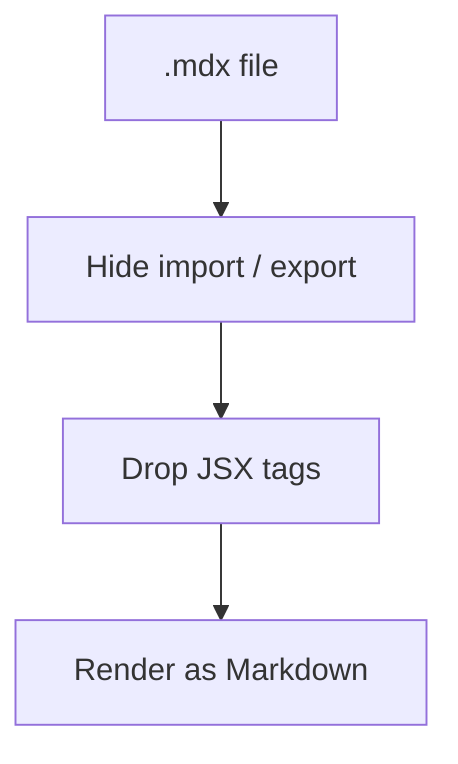
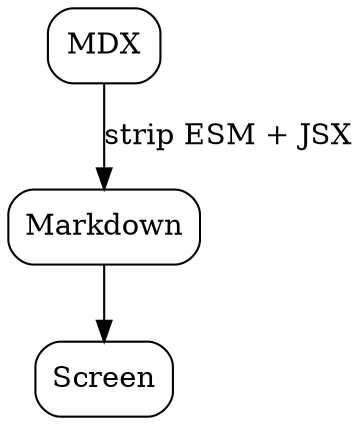

import Tabs from '@theme/Tabs';
import TabItem from '@theme/TabItem';
import { Chart } from '../components/Chart';
import {
  Callout,
  Badge,
} from '@site/src/components';

export const meta = {
  title: 'MDX showcase',
  tags: ['demo', 'mdx'],
};

# MarkRight MDX Showcase

MDX is Markdown with JSX components, used by Docusaurus, Next.js and Astro. MarkRight reads it as Markdown:

- the `import` and `export` lines at the top are hidden;
- JSX component tags such as `<Tabs>` are dropped, and the Markdown inside them is kept;
- everything else renders exactly as in a `.md` file.

See [Showcase.md](Showcase.md) for the full feature tour. :sparkles:

## Components with Markdown inside

<Tabs>
<TabItem value="linux" label="Linux">

Install the **.deb** or **.rpm** package, or run the AppImage.

</TabItem>
<TabItem value="windows" label="Windows">

Run `MarkRight_x64-setup.exe`. Press <kbd>Win</kbd> and type *MarkRight* to start it.

</TabItem>
<TabItem value="macos" label="macOS">

Open the `.dmg` and drag MarkRight to *Applications*.

</TabItem>
</Tabs>

<Callout type="info">

Text inside a custom component stays readable, with **formatting**.

</Callout>

A component with no Markdown inside, like the chart below, simply disappears:

<Chart data={[1, 2, 3]} />

Inline components are dropped too: version <Badge>0.3.1</Badge> keeps its text.

## Code

```jsx
import Tabs from '@theme/Tabs';

export default function Page() {
  return <Tabs defaultValue="linux" />;
}
```

The `import` and `export` lines inside this code block stay, since only top-level ones are hidden.

## Math

The quadratic formula: $x = \frac{-b \pm \sqrt{b^2 - 4ac}}{2a}$

$$
\sum_{n=1}^{\infty} \frac{1}{n^2} = \frac{\pi^2}{6}
$$

## Flowchart



## Graphviz



## Alerts and callouts

> [!NOTE]
> GitHub alerts work in MDX files.

> [!TIP]
> So do Obsidian callouts.

> [!warning]- Folded warning
> Hidden until opened.

## Tables and task lists

| Framework | Uses MDX |
|-----------|:--------:|
| Docusaurus | ✓ |
| Next.js | ✓ |
| Astro | ✓ |

- [x] Hide ESM lines
- [x] Keep Markdown inside components
- [ ] Render the components themselves (not supported)

## Footnotes and links

MDX files can use footnotes.[^mdx] Wikilinks resolve too: [[Second Note]].


[^mdx]: A footnote in an MDX file.
